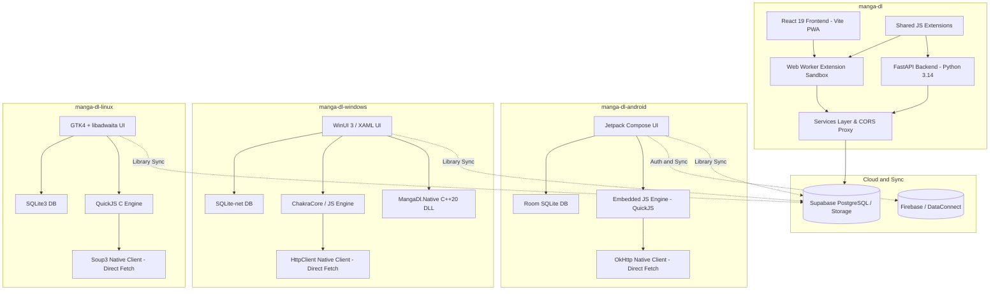

# Cross-Platform Ecosystem Architecture

Last updated: 2026-10-08

The manga-dl ecosystem consists of the core Web and backend repository ([manga-dl](https://github.com/zenmisan/manga-dl)) alongside first-class native client applications for Android ([manga-dl-android](https://github.com/zenmisan/manga-dl-android)), Windows ([manga-dl-windows](https://github.com/zenmisan/manga-dl-windows)), Linux ([manga-dl-linux](https://github.com/zenmisan/manga-dl-linux)), and a containerized self-host stack ([manga-dl-selfhost](https://github.com/zenmisan/manga-dl-selfhost)).



## Data Flow: Web vs Native Platforms

### Web Users (manga-dl frontend)
- Rely on the browser environment and Vite PWA service worker.
- Sandboxed by browser Cross-Origin Resource Sharing (CORS) rules. Outbound source requests run inside Web Workers and relay through backend proxy endpoints (`/api/manga/proxy/html`, `/api/manga/proxy/json`, `/api/manga/image-proxy`).
- Local library items and cached reading states are stored in browser IndexedDB and localStorage.
- Hosted on Firebase Hosting (`manga-dl.web.app`) with the FastAPI backend on Render.

### Native Users (Android, Windows, Linux)
- Pure platform-native applications operating without WebView wrappers or browser sandbox limitations.
- Sandboxed JavaScript scrapers run inside embedded JS engines (QuickJS on Android/Linux, ChakraCore/.NET on Windows) using the unified `apiFetch` bridge contract.
- Requests run through native networking clients (OkHttp, .NET HttpClient, libsoup) directly to upstream sources. No backend proxy or residential IP bottlenecks are required.
- Local archives (CBZ, EPUB, PDF) and metadata persist directly on the OS filesystem and local SQLite databases (Room, sqlite-net, SQLite3).
- Supabase and Firebase connections operate strictly as background synchronizers for reading progress, bookmarks, and user profiles.

## Shared Extension Contract (`apiFetch`)

The same JavaScript extension files located in `backend/app/services/extensions/` run across all platforms without modification. Each extension exposes:

```javascript
var extension = {
  async search(query, page) { /* returns [{id, title, cover_url, provider, url}] */ },
  async getMangaDetail(mangaId) { /* returns {id, title, description, chapters, ...} */ },
  async getPages(chapterId) { /* returns [imageUrl, ...] */ },
  async getChapterText(chapterId) { /* returns {content, format: 'html'|'plain'} */ } // Web novels
};
```

Every platform host injects the standard `apiFetch` bridge function into the JS runtime context:

```javascript
apiFetch(url, options) -> Promise<{ status: number, text: string, json: object }>
```

- **Web Host:** Translates `apiFetch` calls to backend proxy endpoints (`/api/manga/proxy/*`).
- **Native Android:** Calls OkHttp directly with configurable headers, user agents, and cookies.
- **Native Windows:** Calls `System.Net.Http.HttpClient` directly.
- **Native Linux:** Calls libsoup3 directly.

## Client-Side Caching (Web)

All API calls in the web client go through TanStack Query v5 ([queries.ts](file:///home/zenmi/Projects/manga-dl/frontend/src/lib/queries.ts)). Per-endpoint stale times:

| Endpoint | Stale Time |
|----------|-----------|
| `/library` | 30s |
| `/library/stats` | 2min |
| `/sources/builtins` | 5min |
| `/sources/market` | 10min |
| `/manga/updates` | 5min |
| `/users/history` | 60s |

Tab revisits use cached data instantly without spurious re-fetching on window focus (`refetchOnWindowFocus: false`).

## Backend Architecture and Services Layer

The FastAPI backend separates HTTP routing from business domain logic:

```
backend/app/
  api/                      Lightweight FastAPI routers (library.py, manga.py, sources.py, users.py)
  services/                 Domain business logic services:
    archive_converter.py    CBZ page listing, image extraction, PDF and EPUB stream converters
    library_service.py      Library database aggregation, stats, and disk cache
    js_extensions.py        Extension metadata definitions and dynamic script loader
    proxy_service.py        CORS-bypassing proxies for HTML, JSON, and remote cover images
    manga_service.py        Subscribed manga update streams and source migrations
    device_service.py       Device fingerprinting, 3-device limit, 30-day forfeiture lock
    user_service.py         User reading progress, history, stats, and public profiles
  services/extensions/      Standalone JS extension scripts (mangadex, mangakatana, asurascans, etc.)
```

## Frontend Module and Hooks Structure

```
frontend/src/
  pages/          Top-level route components (Dashboard, Reader, MangaDetail, Search, ...)
  components/
    dashboard/    Dashboard sub-components (DashboardHeader, DashboardMangaCard, etc.)
    reader/       Reader sub-components (ReaderHeader, ReaderViewport, ShortcutOverlay)
  hooks/
    useDashboardData.ts        Library state, category filters, upload/scan handlers
    useMangaDetail.ts          Manga metadata orchestrator hook
    useMangaTracker.ts         AniList / MAL search and tracking sync sub-hook
    useMangaChaptersFilter.ts  Chapter search, sort modes, and read status filter sub-hook
    useReaderData.ts           Page/chapter state, manifest fetch, cloud save
    useReaderNavigation.ts     Page navigation, tap zones, dual spreads orchestrator
    useReaderKeybindings.ts    Physical keyboard shortcuts
    useAndroidFeatures.ts      Legacy web/PWA mobile compatibility hooks
  lib/
    queries.ts    Central TanStack Query hooks and query key constants
    api.ts        Axios instance with base URL and API key header
    store.ts      Zustand persist store (UI preferences)
    extensions.ts ExtensionManager — loads and runs JS extensions in Web Workers
    localLibrary.ts  IndexedDB CRUD for local CBZ/EPUB items
    smartUrl.ts   Build /read/:title-slug-:extCode/:chapterSlug URLs
    readTracking.ts  Chapter read state — localStorage and Supabase sync
    categories.ts    Custom categories — localStorage and Supabase sync
```

## Native Repositories Overview

| Repository | Tech Stack | Role | Key Capabilities |
|---|---|---|---|
| [manga-dl-android](https://github.com/zenmisan/manga-dl-android) | Kotlin, Jetpack Compose, Room SQLite, OkHttp | Android Native App | Direct on-device scraping, hardware volume keys, Material 3 UI, background sync, Firebase DataConnect |
| [manga-dl-windows](https://github.com/zenmisan/manga-dl-windows) | WinUI 3, Windows App SDK, .NET 10, C# / C++20 | Windows Native App | Hardware-accelerated Direct2D rendering via C++ DLL, WinUI design tokens, MVVM architecture, native filesystem |
| [manga-dl-linux](https://github.com/zenmisan/manga-dl-linux) | GTK4, libadwaita, Vala / C, SQLite3, Soup3 | Linux Native App | GNOME HIG compliance, native system tray, low memory footprint, MPRIS / desktop integration |
| [manga-dl-selfhost](https://github.com/zenmisan/manga-dl-selfhost) | Docker, Docker Compose, Nginx, FastAPI | Self-Hosting Stack | One-click deployment for personal server instances, centralized library hosting, multi-user sync |

## Backend CORS Origins

The FastAPI backend configures `CORS_ORIGINS` to allow communication from trusted web and local environments:

| Platform | Origin |
|----------|--------|
| Web Development | `http://localhost:5173` |
| Local Production Preview | `http://localhost:4173` |
| Firebase Hosting | `https://manga-dl.web.app` |
| Custom Self-Host Domains | Configured via `CORS_ORIGINS` environment variable |
